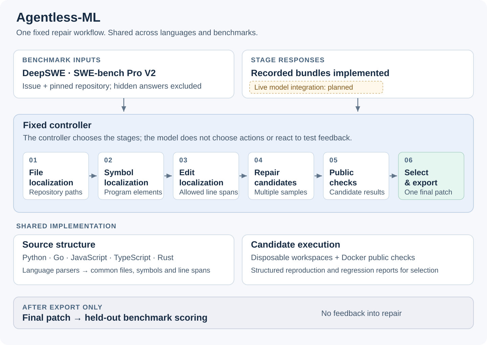

# Agentless-ML

An Agentless-style software-repair framework for **Python, Go, JavaScript,
TypeScript and Rust**, targeting DeepSWE and SWE-bench Pro V2.

The workflow localizes the relevant code, generates several repair candidates,
checks them and selects one final patch. The controller decides the stages;
the model does not choose tools or enter an interactive repair loop.



Public tests can inform selection. Hidden benchmark verification runs only
after the final patch is exported, with no feedback into repair. Recorded stage
responses work today; live model execution is the next integration milestone.

[Documentation](docs/README.md) · [Method and differences](docs/replication-map.md) ·
[Commands](tools/README.md) · [Experiment configuration](docs/experimental-configuration.md)

## Current state

The core workflow is implemented and has end-to-end coverage with saved
responses across all five languages. These runs check the implementation;
they are not live-model benchmark results.

As of **17 October 2026**:

| Area | What is established |
| --- | --- |
| Core workflow | Hierarchical localization, multi-file edits, reproduction and regression checks, deterministic selection and prediction export. |
| DeepSWE | All 113 task descriptions load; 112 have registered usable public baselines. The remaining task, Numba, has completed a separate longer diagnostic but is not registered under that profile. |
| SWE-bench Pro V2 | All 642 task descriptions load. Recorded workflows cover selected Python, Go, JavaScript and TypeScript tasks; workspace checks cover selected tasks from nine repositories. Broad full-suite readiness is incomplete. |
| Model execution | The controller currently consumes recorded responses. Live integration and complete model-budget enforcement remain to be implemented. |
| Research experiments | The protocol is a draft. The eligible task set, model settings, matched Grinta condition and scoring route still need to be fixed before reporting results. |

These are implementation and environment-readiness counts, not solved-task
results. Numba's longer run finished in about 95 minutes with four retained
cache-related failures/errors; see the [full record](docs/history/deepswe-numba-three-hour-attempt-2026-10-17.md).
Current coverage is tracked in [DeepSWE](docs/deepswe.md) and
[SWE-bench Pro V2](docs/swe-bench-pro-v2-readiness.md). Earlier investigations
live in [the development history](docs/history/README.md).

## Getting started

Python 3.11 or newer is required. With [uv](https://docs.astral.sh/uv/):

```bash
git clone https://github.com/josephsenior/Agentless-ML.git
cd Agentless-ML
uv sync --extra dev --locked
uv run --no-sync pytest
```

Benchmark loaders also need the optional dataset dependency:

```bash
uv sync --extra dev --extra benchmarks --locked
```

An ordinary virtual environment works too:

```bash
python -m venv .venv
python -m pip install -e '.[dev]'
python -m pytest
```

Framework tests do not need model credentials or hidden benchmark data.
Some checks require an optional local toolchain and are skipped when it is
unavailable. Actual benchmark runs need separately prepared repositories,
pinned images and Docker.

## Commands

The [tools guide](tools/README.md) separates the main commands, recorded
replays, fixture maintenance and repository-specific diagnostics.

For the small recorded demonstration, inspect its options first:

```bash
uv run python tools/demo_fixed_workflow.py --help
```

With Docker running and the demonstration image already available, the same
script runs the authored example and exports its selected patch:

```bash
uv run python tools/demo_fixed_workflow.py --output artifacts/fixed-workflow
```

For benchmark work, use the documented workflow and survey commands in
[DeepSWE](docs/deepswe.md), [SWE-bench Pro](docs/swe-bench-pro.md) and
[V2 provisioning](docs/batch-v2-provisioning.md).
Post-selection scorers are separate commands; running a public regression
suite does not produce a benchmark score.

## Code and records

| Location | Contents |
| --- | --- |
| `src/agentless_ml/` | Shared schemas, language structure, localization, repair, workspaces, validation, controller and scoring. |
| `tests/` | Framework tests and pinned parity fixtures. |
| `tools/` | Command-line entry points and development helpers, indexed in the tools guide. |
| `experiments/` | Reviewed configurations, corpus pins and compact run evidence. |
| `docs/` | Current method, implementation and benchmark guides. |
| `docs/history/` | Earlier setup investigations and run records. |
| `artifacts/` | Ignored local run outputs; some published development records cite these files. |

See [the experiment records guide](experiments/README.md) before removing
generated outputs. Raw reports and predictions may still be needed to
reproduce a result even though Git ignores them.

## Relationship to Agentless

This is a separate implementation based on
[Agentless](https://github.com/OpenAutoCoder/Agentless), intended as a fixed-workflow
baseline for comparison with Grinta. The aim is to generalize source representation
and benchmark execution without making the repair process an adaptive agent.

The pinned reference is kept unchanged. Python parity is checked at specific
boundaries, while multilingual support and several repair/selection choices
extend or differ from that reference. This is not a claim of full upstream parity.

[The replication map](docs/replication-map.md) records those differences and
their evidence. [The invariants](docs/agentless-invariants.md) state what stays
fixed, and [the design decisions](docs/adr/0001-separate-generalized-baseline.md)
explain the implementation boundary. Upstream revisions and fixture provenance
are listed in [PROVENANCE.md](PROVENANCE.md).

## Remaining work

The next implementation milestone is live model execution through the existing
stages, with enforced call, token and time budgets. Then calibrate a small
development pilot and agree the experimental configuration with Professor Zhang,
including the matched Grinta condition.

Benchmark provisioning can expand by repository as the chosen experiment
requires. Loading every description, running a selected smoke check and
establishing a complete public baseline are different levels of coverage.
Method differences and the remaining integration gaps are listed in
[the proposed configuration](docs/experimental-configuration.md).

## License

[MIT](LICENSE). Upstream fixtures and source-derived regression artifacts retain
the provenance and applicable licenses of their original projects.
